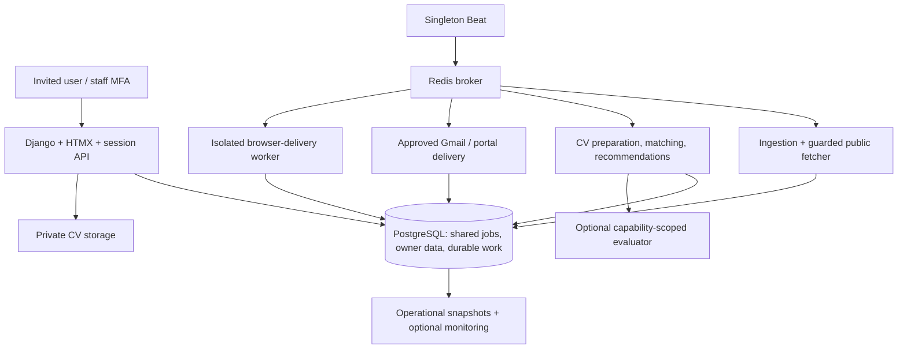

# Architecture

Status: implemented contracts reviewed against repository code, 2026-11-13.
This describes behavior, not runtime health, live-source rights or production readiness.
Pending capabilities belong in [milestones](MILESTONES.md).

## Components and ownership

Django's `jobs` app, PostgreSQL durable state, Redis/Celery and server-rendered HTMX
remain the application. Optional Rust Infinity evaluates vacancies; it does not
replace Django, ingest jobs, approve applications or send messages.

Shared entities: Company, CompanyAlias, Source, Job, JobOrigin, JobEvent, IngestionRun.
Private entities: SavedJob, Document, ResumeProfile, PreparedResume, Application,
batches, preferences, Gmail grants and agent executions. Invitation/AuditEvent record
security/workflow activity. AuditEvent is mutable application data, not an external
tamper-proof ledger. Preserve existing services instead of creating parallel v2 models.

Queues are `celery`, `ingestion`, `preparation`, `delivery`, `browser-delivery`;
routing is in `config/settings.py`. Beat recovers lost broker publications from
PostgreSQL dispatch reservations. Tasks may repeat; external exactly-once delivery
is not promised. Redis is not the durable source of approval or lifecycle truth.

## Catalogue, ingestion and source rights

Company represents an independently reviewed employer. Company-career Source rows
have explicit ownership; supplementary job boards do not establish employer identity
or authoritative closure. `Job.company` is reported employer text; `company_profile`
is its optional employer foreign key. Similar names alone never merge companies.

`catalogue.py` and discovery services propose sources. `inventories.py` returns
postings, scope, completeness, cursor and expected totals. `ingestion.py` leases,
normalizes, deduplicates and commits origins. Prefer stable provider/board/posting
identity; canonical HTTPS URL is a fallback, titles are not identity keys. Preserve
provenance and curated overrides independently of imported content.

Only complete successful inventories count absence. Two such absences can close a
job under reviewed authoritative scope and an enabled closure flag. Partial scans,
rejected rows, changed snapshots and failures cannot prove absence. Overlapping open
employer observations keep a job open; reappearance resets absence and records reopening.
Closure defaults to shadow mode. JobOrigin/JobEvent preserve observation/transition
history. Publication changes and reopening are distinct signals. Never label first-seen
or provider-updated time as publisher publication time. A visible listing does not
prove active interviewing.

`network.py` enforces HTTPS/public DNS, pins addresses for TLS, checks redirects and
bounds time/bytes. `crawl.py` shares origin/global leases and cooldowns. Default host
spacing is zero; a positive pilot budget must be configured deliberately.

Public readability, robots allowance, employer identity and reuse rights are separate.
Existing enabled/authoritative flags do not record permitted uses, expiry or revocation.
Recognized official ATS discovery can currently activate sources after identity review
without a durable scoped grant. This remains a blocker for new live-source expansion.
See [operating permission requirements](OPERATIONS.md#source-permissions).

The offline `fixture_sources.py` contract reuses existing collectors with bounded
synthetic bytes, reserved links, snapshot pagination and fixture-specific grant checks
on every page. `JOB_SOURCE_FIXTURES_ENABLED=False`; tests override it. There is no
network transport, database write, web/task endpoint or live adapter registration.
Fixture grants never authorize real ingestion; durable source permissions are planned.

## Candidate facts, CVs and matching

The UI exposes one current base CV and one editable attachment per application.
Base edits do not rewrite application attachments. Source/profile references remain
where needed by provenance. Generated artifacts are excluded from base-CV selectors.
Confirmed facts can be reordered; AI may select fact IDs, never invent qualifications.
Private PreparedResume caching includes owner, input, rendering/font and model versions.
PDFs are hashed, safely named and authenticated for download. Invalid/encrypted/
image-only inputs and unsupported output glyphs fail visibly.

Deterministic preference checks precede paid evaluation. Scores measure supported
evidence/technology coverage, not hiring probability or all legal/seniority/salary/
commute requirements. Unknown mandatory facts need review. PDF-derived and editable-
profile evaluations retain distinct input identities; stale results cannot authorize sends.

AI costs/tokens are transactionally reserved; unknown outcomes retain conservative
reservations. Configured limits are not invoices. Infinity receives a short-lived
capability to one active frozen context, bounded calls/deadlines and no delivery tools.
Its restricted schema cannot read application/auth/document tables. Runtime snapshots
are private. Cross-store atomicity and exactly-once inference are not promised;
cancellation cannot recall an in-flight request.

## Approval, delivery and uncertainty

`draft → approved → submitting → confirmed | failed | unknown`

Approval binds recipient, subject/body, sender, attachment ID/hash and relevant portal
answers/schema. Editing/regeneration clears approval. Submitting, confirmed and unknown
content is locked. Worker preflight locks the row, validates approval/bytes, and commits
SUBMITTING before external I/O. A unique owner/job constraint and durable claim stop
replayed sends for that job; future cross-mirror dedupe relies on canonical identity.

UNKNOWN means uncertain and is never blindly resent. Explicit rate-limit rejections
may schedule bounded unchanged-content retries; ambiguous responses may not. Gmail
reconciles SENT by RFC Message-ID. Confirmation proves transport, not employer receipt
or consideration. Recruiting tracking is separate. Batch preparation, saved answers
and CV upload are not standing consent. Cancellation stops pending work, not already
accepted requests. General bounded autopilot and HR-inbox classification are absent.

New drafts prefer a reviewed company application address or explicit job email;
otherwise use the portal workflow. Supported employer routes are not generic platform
submission rights. See [integrations](OPERATIONS.md#integrations).

## Security, search and deployment boundaries

Invite-only one-use expiring tokens, sessions/CSRF, login throttling and staff TOTP
protect entry points. Object-level owner checks remain mandatory for private data,
including API/HTMX/background jobs. Authentication alone never grants ownership.
Source metadata is separate from CVs, answers, OAuth grants and private messages.

Treat all postings, CVs, HTML, emails and model output as untrusted data, never commands.
Escape output, reject unsupported schemas and constrain resources. Encrypt OAuth grants,
use separate secrets/least privilege, and require explicit approval before external
uploads, applications, messages or follow-ups. Never bypass login/CAPTCHA/anti-bot barriers.

Current company/job deletion cascades into dependent applications/audit records under
the existing migrations; document references remain protected where configured.
Changing retention/deletion policy needs a deliberate product/schema decision.
Search uses PostgreSQL generated full-text vectors/GIN indexes, bounded pagination and
eager provenance loading. Optimize measured workloads, not speculative scale.

Local Compose is development, not proven production infrastructure. Region/budget,
TLS/proxy/IAM, backups/RPO/RTO, data erasure and retention need deployment review.
Current migration files are authoritative; never replay the replaced old migration
chain or reset valuable data as a setup shortcut. Jobstream is the canonical name;
no mass rename is needed. Historical consent or documentation commands authorize nothing.
