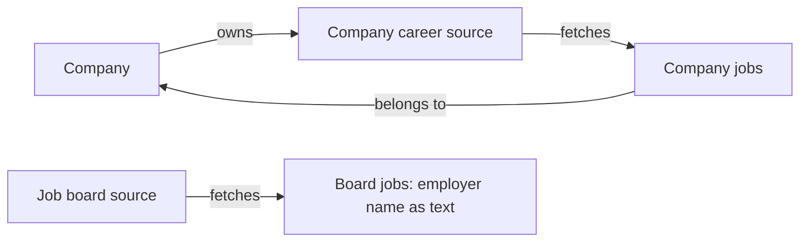

# Companies, job sources, and jobs

The development database now starts from **one `jobs/0001_initial.py` migration**.
It does not replay historical imports, backfills, company merges or source activation.
Do not apply this replacement history to an old database or use `--fake-initial`.
Create an empty development database first.

## Three product entities

- **Company** is an independently discovered employer: name, website and review state.
  Company records come from directories, manual entry or CSV—not job-board employer labels.
- **Job source** is a fetch endpoint with an explicit kind: **Company careers** or
  **Job board**. Its adapter determines how to fetch and normalize positions.
- **Job** is a position, containing the reported employer name and application route.
  Company-career jobs link to their owning Company. Board jobs have no Company link.



`Company.source` has been removed. There is no reverse legacy link from a Company
back to a board or feed. `Source.company` is the ownership link for career endpoints.
A board cannot have an owning Company or authoritative employer lifecycle state.
An enabled career endpoint must have an explicit Company; ingestion never guesses
or creates one from an employer name. Duplicate source URLs are prohibited.

In the current Python model, `Job.company` stores the reported employer text and
`Job.company_profile` stores the optional Company foreign key. Admin labels distinguish
these as **Employer name from posting** and **Company profile** (used only for career jobs). They
represent separate information: a reported name is not verified employer identity.

`JobOrigin` records where a position was observed and when. It supports retries,
provider identities, publication history, and overlapping career endpoints. It is
shown inside a job's detail page rather than treated as another user-facing entity.
`Job.employer_source` records authoritative employer verification; it is not the
board's application route. `Job.email_source` records evidence for an application
email address. These optional evidence links never authorize sending an application.

## Two ingestion paths

**Company path:** directory/manual discovery → pending Company → official-site review
→ career endpoint/adaptor review → job collection → position normalization → supported
application adapter. Unknown hiring status does not prevent a Company from being saved.

**Board path:** board adapter → positions with employer text and original board route.
This includes Secret Tel Aviv, Arbeitnow and Himalayas. Board jobs do not create Company
records, link to existing Companies by name, or grant authority over company job closure.
Board listings and employer listings can remain separate when identity is uncertain;
a stale board copy cannot reopen or overwrite an employer vacancy.

Collection support does not imply submission support. Applications still require owned
CVs, truthful tailoring, exact previews and user approval. CAPTCHA or unsupported portals
require manual action, never bypass. Recommendations are a later use of stored jobs and
user profiles; they do not change source ownership or send anything automatically.

## Clean development bootstrap

After migrating an empty database:

```sh
DEBUG=1 uv run python manage.py bootstrap_development
```

The idempotent command creates:

- Four pending employers: Cato Networks, GitLab, Camunda and Akeyless.
- Four company-owned career endpoints and three boards: Secret Tel Aviv, Arbeitnow,
  and Himalayas.
- One Pituchim directory campaign in all-company catalogue mode.

Every source/campaign starts disabled. No jobs, CVs, applications, emails, paid calls
or network crawls are created by bootstrap. Review and enable the intended collection
work explicitly. Jobs and Companies lists will grow only after those collection or
discovery runs actually execute.

The old migration-specific backfill tests are retired. New regression tests cover the
fresh schema, idempotent bootstrap, source ownership, board isolation and existing
collection/application safety contracts.

## Local environment reset

A full Jobstream reset means removing **only this Compose project's** containers and
named volumes. It removes PostgreSQL records, Redis messages/caches and container-local
uploaded files. It does not delete source code, `.env`, other Docker projects or images.

When preserving superuser/MFA, export only the superuser's authentication fields and
OTP devices/recovery tokens to a private file before volume deletion. Restore after
migration, reset their database sequences, compare the restored records, then remove
the temporary export. Do not display password hashes or MFA secrets in logs or chat.
All ordinary users, CV/profile records, connected-account tokens, jobs, applications,
old source definitions and task messages are discarded.


Verified reset checkpoint (2026-11-07): all Jobstream containers were recreated;
PostgreSQL/Redis volumes and container-local storage were replaced. Exactly one
superuser and its one confirmed TOTP device were restored and field-verified; the
private export was removed. Fresh data: 4 companies, 7 disabled sources, 1 disabled
Pituchim campaign, no jobs/applications/documents/mail connections. The optional
Infinity runtime's empty schema and restricted role were reprovisioned using
`python -m scripts.provision_infinity`. Health/login HTTP endpoints returned 200.
